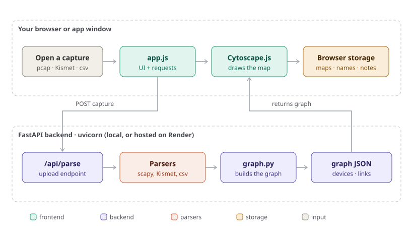
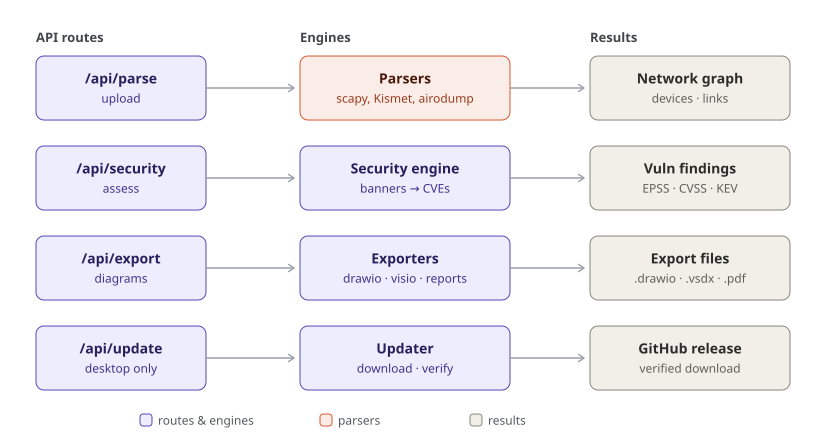
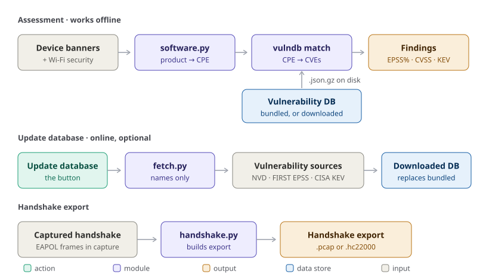

# How NetSeer works

NetSeer turns a network capture into a map you can read. This page is the in-depth tour of the
pieces that make that happen — the browser front end, the FastAPI back end, the parsers and
exporters, and the few outside services it talks to for vulnerability data and updates.

> **Looking ahead:** two design docs cover where NetSeer is going — the
> [integration API](integration-api.md) (companion apps like WaveTop pushing captures and live
> wardrive views) and the [Electron migration plan](electron-migration.md) (a richer desktop shell).

The same program runs three ways, and the architecture is identical in all of them; only *where*
the back end runs changes:

| Mode | Back end runs | UI shows in |
| --- | --- | --- |
| Desktop app (Windows / Linux) | On your machine, on `127.0.0.1` (Electron starts it as a sidecar) | Its own Electron window |
| From source (`uv` / `pipx`) | On your machine | Your browser |
| Hosted ([netseer.onrender.com](https://netseer.onrender.com)) | On Render | Your browser |

## The data path: capture → map

1. You **open or drop a capture** in the browser or app window.
2. `app.js` (plain JavaScript — no framework) uploads it to the back end with `POST /api/parse`.
3. The back end hands the file to the right **parser**, which reads the frames and records, and
   `graph.py` assembles a **graph** of devices, links, services, and VLANs.
4. The graph comes back as JSON; **Cytoscape.js** lays it out and draws the terrain-style map.
5. Your **maps, names, and notes live in the browser** (local storage). The capture is sent to the
   back end only to build the graph — see [Data and privacy](#data-and-privacy) below.

Exports and security checks follow the same shape: the front end sends the current graph to a back
end endpoint and gets a result (a findings list, a diagram file, a PDF) in return.

## Front end

A single-page app under `src/netseer/web/`:

- `index.html` + `styles.css` — markup and the theme system (token sets on `[data-theme]`).
- `app.js` — all UI logic: opening captures, calling the API, the sidebar, search, details,
  compare, export menus, and settings.
- `vendor/` — the one third-party dependency, **Cytoscape.js**, which renders and lays out the map.

There is no build step and no `node_modules`; the files are served as-is. State that must persist
(your maps, device names, notes, chosen theme) is kept in the browser's local storage, not on the
server.

## Back end

A **FastAPI** app in `src/netseer/web.py`, served by **uvicorn**. It does two jobs: serve the static
front end at `/`, and answer the `/api/*` calls. Each route group maps to an engine module.

### Parsers (`src/netseer/parsers/`)

Each input format has its own reader; all of them feed `graph.py`.

| Module | Reads | Notes |
| --- | --- | --- |
| `pcap.py` | `.pcap`, `.pcapng` | Full frame decode with **scapy** (Wi-Fi, IP, services, EAPOL handshakes) |
| `fastwifi.py` | Large Wi-Fi `.pcap` | Fast path that skips scapy's per-frame cost on long captures |
| `kismetdb.py` | `.kismet` | Kismet's native SQLite log; two passes for the best device detail |
| `kismet.py` | `.netxml`, `.csv` | Kismet's exported summaries |
| `airodump.py` | airodump-ng `.csv` | Access points and clients from airodump sessions |
| `wigle.py` | WigleWifi `.csv` | WiGLE wardrives: access points, plus Bluetooth/BLE and cellular towers |
| `craxiom.py` | Network Survey `.csv` | Craxiom Network Survey Wi-Fi exports |

Large captures use the async job endpoints (`/api/parse/jobs/*`) so the UI can show progress and
let you cancel, instead of blocking on one request.

### Graph (`src/netseer/graph.py`)

Builds and merges the device graph: it de-duplicates devices across frames, works out links
(layer 2, layer 3, services, wireless associations), groups subnets and VLANs, and attaches the
extras each device reveals — service banners, TLS versions, and captured handshake frames.

### Exporters (`src/netseer/exporters/`)

Turn the current graph into files other tools can open. Exports keep their own fixed colours, so
they look the same whatever theme you use.

| Module | Produces |
| --- | --- |
| `drawio.py` | draw.io / diagrams.net XML (`/api/export/drawio`) |
| `visio.py` | Visio `.vdx` and `.vsdx` (`/api/export/vdx`, `/vsdx`) |
| `reports.py` | PDF report (ReportLab) and CSV (`/api/export/report.pdf`, device exports) |
| `layout.py` | Shared diagram coordinates (shape centres) used by the exporters |

### Updates

The desktop app updates itself through **electron-updater**: the Electron shell (`electron/`) checks
the **GitHub Releases** API, downloads the new installer or AppImage, verifies it against the
release's `latest.yml` / `latest-linux.yml` metadata, and (with the user's consent, or silently if
they left auto-update on) restarts into it. The Python backend does not self-update — `/api/health`
reports `"updater": false`, and the browser's Settings → Updates pane only links to the releases. A
source install or the hosted copy updates the normal way for how it was installed.

## Security subsystem (`src/netseer/security/`)

NetSeer checks each device's Wi-Fi security, the services it offers, its TLS versions, and the
software versions in its banners against known vulnerabilities — and it does this **offline by
default**.

**Assessment** (`/api/security/assess`) runs entirely on your machine:

- `software.py` reads the product and version from a device's banners and maps it to the
  **CPE** vendor:product names the NVD files vulnerabilities under.
- `vulndb.py` matches those against a vulnerability database kept on disk as `vulndb.json.gz`.
- The result is a findings list with an **EPSS** exploitation-likelihood percentage, a **CVSS**
  severity, and a **CISA KEV** flag for anything known to be exploited in the wild.

**Updating the database** (`/api/security/refresh`, the *Update database* button) is the only part
that uses the internet, and only when you ask. `fetch.py` downloads fresh data from three public
sources — the **NVD** (CVE + CPE), **FIRST EPSS** (exploit scores), and **CISA KEV** (known
exploited) — asking only for product names, never anything about your maps. The downloaded copy
then takes precedence over the bundled one.

**Handshake export** (`/api/security/handshake`) is built only from frames already in your capture:
if a WPA 4-way handshake was recorded, `handshake.py` can write it out as a `.pcap` (for Wireshark)
or an `.hc22000` (hashcat) file, for testing the password strength of your own network.

## API reference

Every route the front end calls, grouped by area:

| Area | Routes |
| --- | --- |
| Parse | `POST /api/parse`; `POST /api/parse/jobs`, `GET /api/parse/jobs/{id}`, `POST /api/parse/jobs/{id}/stop`, `DELETE /api/parse/jobs/{id}`, `GET /api/parse/jobs/{id}/result` |
| Samples | `GET /api/samples`, `GET /api/samples/{id}/graph` |
| Security | `POST /api/security/assess`, `GET /api/security/database`, `POST /api/security/discoverable`, `POST /api/security/handshake`, `POST /api/security/refresh`, `POST /api/security/refresh/cancel` |
| Export | `POST /api/export/drawio`, `/api/export/vdx`, `/api/export/vsdx`, `POST /api/export/device/{fmt}`, `POST /api/export/report.pdf` |
| Maps | `POST /api/compare`, `POST /api/device/properties`, `POST /api/unwanted/dump` |
| Lifecycle | `POST /api/heartbeat`, `GET /api/health` |
| App | `GET /`, `GET /favicon.ico` |

## Data and privacy

- **Your maps stay in your browser.** Names, notes, and the maps themselves live in local storage,
  not on the server.
- **Captures are processed, not kept.** A capture is sent to the back end only to build the graph.
  On the desktop and source installs the back end *is* your machine, so nothing leaves it. The
  hosted copy processes the file to draw the map and does not keep it (and limits uploads to 20 MB).
- **The internet is optional.** The only outbound calls are the security database refresh, the geo
  map's opt-in OpenStreetMap tiles (only while **Street map** is on), and, on the desktop app, the
  Electron self-updater — each only when you ask (or, for updates, if you leave auto-update on). The
  geo map is otherwise offline, so GPS locations never leave the machine. Everything else works with
  no network.

## External services

| Service | Used for | When |
| --- | --- | --- |
| NVD (`services.nvd.nist.gov`) | CVE and CPE data | Database refresh only |
| FIRST EPSS (`epss.empiricalsecurity.com`) | Exploitation-likelihood scores | Database refresh only |
| CISA KEV (`cisa.gov`) | Known-exploited list | Database refresh only |
| GitHub Releases (`api.github.com`, `github.com`) | Update check and download | Desktop updater only |
