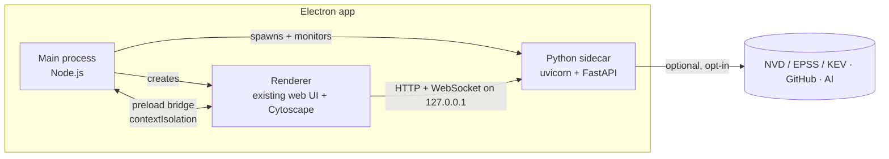

# NetSeer: Electron migration plan (design)

**Status:** Proposed · **Audience:** NetSeer developers · See also [architecture.md](architecture.md),
[integration-api.md](integration-api.md)

NetSeer's desktop window moves from **pywebview** to **Electron**, to unlock a richer desktop
feature set (frameless window, tray, native menus, notifications, file associations, deep links) and
a future in-process plugin surface. This is a **shell swap**, not a rewrite: the Python back end and
the web UI are unchanged.

## Goals and non-goals

**Goals**

- Replace the pywebview window with an Electron shell that loads the existing web UI.
- Keep the Python/FastAPI back end exactly as-is, run as a **managed sidecar**.
- Reach feature parity with today's desktop app, then add desktop features pywebview can't do well.
- Lay groundwork for deep links and notifications that make the [integration API](integration-api.md)
  (WaveTop push, live view) feel native.

**Non-goals**

- No rewrite of parsers, the graph builder, the security engine, or exporters — they stay Python.
- No change to the **source** install or the **hosted** (Render) copy; both stay browser-based.
- The [integration API](integration-api.md) work is **independent** and ships on its own track — it
  does not depend on this migration.

## Target architecture

- **Main (Node)** owns the app lifecycle: it spawns the Python sidecar on a random loopback port,
  waits for `/api/health`, then opens the window pointed at it. It also owns native features (tray,
  menus, notifications, deep links) and, later, the plugin host.
- **Renderer** is the current `index.html`/`app.js`/Cytoscape UI, loaded over `http://127.0.0.1:<port>`.
  It keeps talking to the back end over HTTP/WebSocket exactly as it does now — minimal UI change.
- **Python sidecar** is the existing app, frozen with PyInstaller, launched as a child process.
- **Security:** `contextIsolation: true`, `nodeIntegration: false`, sandboxed renderer; the only
  Node capability exposed to the page is a small, explicit **preload** bridge (window controls,
  deep-link events). The page's data still comes from the local HTTP API, not Node.

## What this unlocks (the richer feature set)

| Feature | Why Electron makes it easy | Ties to |
| --- | --- | --- |
| Frameless window + custom title bar | `titleBarStyle: 'hidden'` + `titleBarOverlay` (Win), `-webkit-app-region: drag`; native resize/snap kept | the earlier frameless discussion |
| System tray + background run | first-class `Tray` API | live wardrive running in the background |
| Native menus & global shortcuts | `Menu`, `globalShortcut` | power-user workflows |
| OS notifications | `Notification` API | "WaveTop sent a capture", live alerts |
| File associations (`.pcap`, `.kismet`) | `electron-builder` `fileAssociations` | double-click a capture → opens NetSeer |
| Deep links (`netseer://…`) | `app.setAsDefaultProtocolClient` | WaveTop → NetSeer handoff |
| Multi-window | multiple `BrowserWindow`s | compare surveys side by side |
| In-process plugins (future) | Node main + `WebContentsView` + preload | third-party UI panels |

## Migration phases

Each phase is shippable and reversible; pywebview stays the default until parity is proven.

- **Phase 0 — decouple (now).** Build the [integration API](integration-api.md) and live view on the
  current app. Nothing here blocks on Electron.
- **Phase 1 — Electron shell at parity.** New `electron/` workspace. Main spawns the PyInstaller
  Python sidecar, health-checks it, opens the window. Match today: downloads allowed, external links
  open in the browser, `min_size`, background colour, the `NETSEER_MODE=desktop` signal. Ship behind
  a separate build artifact so the pywebview build keeps shipping.
- **Phase 2 — native shell features.** Frameless window + custom title bar (gated on desktop),
  native application menu, system tray.
- **Phase 3 — integration-native UX.** `netseer://` deep links and `.pcap`/`.kismet` file
  associations, OS notifications for capture-received and live events.
- **Phase 4 — plugin host.** JS/TS UI extensions in the renderer plus Python back-end plugins in the
  sidecar (new parsers, exporters, data sources).
- **Phase 5 — cut over.** Make Electron the default desktop build; retire the pywebview path once
  parity and signing are confirmed. Source and hosted modes are untouched throughout.

## Packaging, signing, and updates

- **Builder:** `electron-builder`, producing the same artifact set NetSeer ships today — Windows
  installer + portable, Linux AppImage + tarball, with `SHA256SUMS`. The Python sidecar is bundled
  as extra resources (PyInstaller output under `resources/`).
- **Signing:** reuse the plan in [packaging/windows/SIGNING.md](../packaging/windows/SIGNING.md);
  Electron is signed the same way (Authenticode on Windows).
- **Auto-update:** evaluate `electron-updater` (GitHub provider) against the current
  [`updater.py`](../src/netseer/updater.py). Either way, **keep the SHA-256 verification** against the
  release `SHA256SUMS` — that behaviour is a NetSeer invariant, not a pywebview detail.
- **Size:** expect ~120–150 MB installed (bundled Chromium + the Python sidecar), up from the current
  lean bundle. This is the accepted cost of the platform direction.

## Risks and mitigations

| Risk | Mitigation |
| --- | --- |
| Sidecar startup races the window | Health-poll `/api/health` before loading the URL (the pywebview build already waits for the port) |
| Orphaned Python process on crash | Main tracks the child PID and kills it on `will-quit`; sidecar also self-exits on lost heartbeat |
| Bigger download / RAM | Expected; justified by the platform goals. Keep source/hosted modes for the lean path |
| Code-signing + notarization churn | Stand up signing in Phase 1 so it isn't a release-day surprise |
| Cross-platform regressions | CI builds both OSes per PR (as today); smoke-test the sidecar handshake on each |
| Two shells during transition | Phase-gated; pywebview stays default until Phase 5 |

## Repo impact

- New `electron/` directory (main process, preload, `electron-builder` config).
- New or updated CI: build the Python sidecar, then the Electron app, per OS.
- `desktop.py` stays for the source install's own-window path; the Electron shell replaces it only in
  the packaged desktop build.

## Open questions

- `electron-updater` vs. keeping `updater.py` driving updates from the Node side.
- MSIX (today's Windows packaging route) vs. NSIS via `electron-builder`.
- Whether Phase 4's plugin host also exposes the integration API's live feed to plugins.
- Minimum macOS story (source-only today) — does Electron make a signed mac build worth doing?
