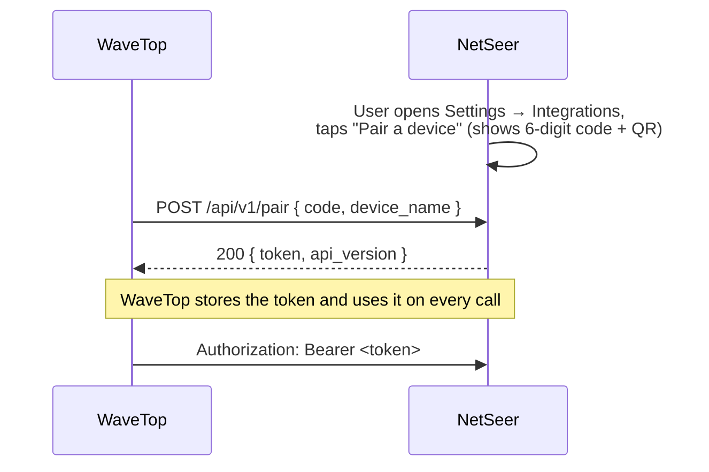
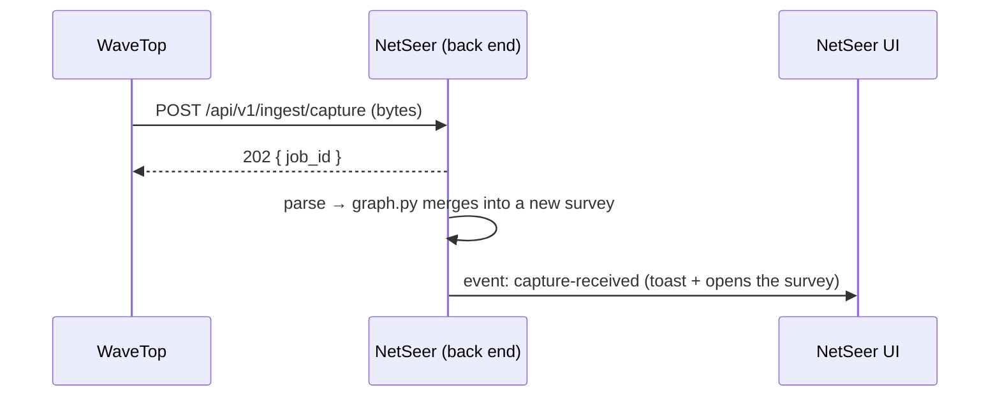
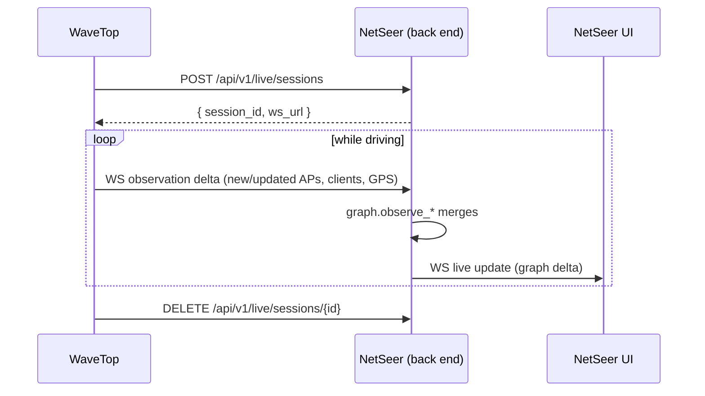

# NetSeer integration API (design)

**Status:** Draft · **Audience:** NetSeer and companion-app developers · See also [architecture.md](architecture.md)

NetSeer's back end becomes a small local **hub** that companion apps talk to. The first client is
**WaveTop** (the Android surveying app), with two near-term needs and one later one:

1. **Push a capture** to a running NetSeer with one button — no "save to a file, then open it".
2. **Live view** — stream observations to NetSeer as a survey happens and watch the map build.
3. **AI analysis** — ask NetSeer to help interpret a map (later).

All three live in the existing Python/FastAPI back end and reuse the existing parse-and-merge
pipeline ([`graph.py`](../src/netseer/graph.py)); they are independent of the window shell.

**Implementation status**

| Piece | State |
| --- | --- |
| Pairing + device tokens (`/api/v1/pair/start`, `/api/v1/pair`), discovery (`/api/v1/info`) | **shipped** ([`integration.py`](../src/netseer/integration.py)) |
| Capture push (`POST /api/v1/ingest/capture`) | **shipped** — becomes a normal reading job |
| Surfacing a pushed capture in the running UI (`WS /api/v1/events`) | **shipped** — the map opens on its own |
| Settings → Integrations UI (pairing code + device list + revoke) | **shipped** |
| LAN binding toggle (**Allow devices on my network**) — pair/push over the network | **shipped** |
| USB link (**Connect phones over USB**) — automatic `adb reverse` for plugged-in phones | **shipped** ([`usb.py`](../src/netseer/usb.py)) |
| Live-view WebSocket session (stream a survey onto the map as it happens) | **shipped** ([`live.py`](../src/netseer/live.py)) |
| AI analysis | planned |
| mDNS discovery (auto-find NetSeer on the network) | planned |

## Principles

- **Local-first and private.** Default binding stays `127.0.0.1`. Reaching NetSeer from another
  device is **opt-in** and always authenticated.
- **Reuse the pipeline.** Pushed captures and live observations flow through the same graph builder
  and merge logic the file parsers already use.
- **One contract, many clients.** WaveTop, NineLives, and future tools share the schemas below.
- **Additive.** New endpoints live under `/api/v1/…`; today's endpoints are unchanged.

## Transport and binding

| Setting | Default | Opt-in |
| --- | --- | --- |
| Port | `47331` (desktop app and `netseer`); if it's taken at launch, a random free port for that run | `--port` |
| Bind address | `127.0.0.1` | `0.0.0.0` (LAN) when the user enables **Allow devices on my network** |
| OS firewall | Windows blocks the inbound port even when bound to `0.0.0.0` | enabling sharing prompts (UAC) to add a program-scoped inbound rule for `netseer-server.exe` (Private+Domain); a Settings hint carries the `New-NetFirewallRule` fallback. macOS prompts on first bind; Linux: open the port in ufw/firewalld |
| USB | NetSeer runs `adb -s <serial> reverse tcp:47331 tcp:<its port>` for every authorised phone, again after a re-plug | turn off **Connect phones over USB** |
| Auth | required for all `/api/v1/*` | — |
| Discovery | — | mDNS/Bonjour service `_netseer._tcp` advertising host, port, and name |
| TLS | plain HTTP on loopback | self-signed TLS offered when bound to the LAN; the pairing step pins it |

The companion app finds NetSeer by mDNS, by a manually entered `host:port`, or by scanning the
pairing QR (see [Pairing QR payload](#pairing-qr-payload) below). Over a USB cable the phone uses
`http://127.0.0.1:47331`, which NetSeer's USB link forwards to whatever port it is actually on.

## Pairing and auth

A short, user-visible pairing handshake, managed in **Settings → Integrations**:



- NetSeer's own window mints the code via `POST /api/v1/pair/start` (guarded by host +
  `X-NetSeer-Window: 1`, so only the app's page can start pairing); the user reads it off the screen.
- The pairing code is short-lived (5 minutes) and single-use. After 5 wrong codes, every live code
  is cancelled and the user starts a new one.
- The returned **device token** is long-lived, scoped to that device, and listed/revocable in
  Settings → Integrations.

### Pairing QR payload

When NetSeer is shared on the network, **Pair a device** also shows a QR beside the 6-digit code. It
bundles that same code with the address(es) the phone might reach NetSeer on, so pairing is one scan
instead of typing an address and code. The text code stays as the manual fallback. The QR encodes a
single URI:

```
netseer://pair?v=1&code=<code>&host=<addr:port>[&host=<addr:port>...][&name=<name>]
```

| key | notes |
| --- | --- |
| `v` | format version, currently `1` (required; a scanner rejects unknown versions) |
| `code` | the current pairing code — the same digits shown on screen, an opaque 6-character string (leading zeros preserved) |
| `host` | **repeatable**. An address to reach NetSeer on, as `host:port`. A scheme is allowed (`https://host:port`); default `http`. Values are kept literal (`:` and `/` are not percent-encoded). **Ordered remote first** (Tailscale / overlay, `100.64.0.0/10`) then LAN — the scanner tries each in order, does `GET /api/v1/info`, and uses the first that answers |
| `name` | optional display name for the "pair with …" confirmation (NetSeer sends its hostname); **percent-encoded** |

The host list comes from `GET /api/v1/network` (`addresses`, remote-first; `name` is the hostname),
plus the port the page is served on. No server API change is involved: after scanning, the app still
calls `GET /api/v1/info` then `POST /api/v1/pair { code, device_name }`. The QR is shown only when
**Allow devices on my network** is on (NetSeer bound to `0.0.0.0`); otherwise just the manual code
appears, and USB pairing does not use the QR.
- Every `/api/v1/*` call carries `Authorization: Bearer <token>`.
- API version is negotiated with the `X-NetSeer-API: 1` request header; the server echoes the
  version it served.

## Endpoints

### Discovery

`GET /api/v1/info` → capabilities and version, so a client can feature-detect.

```json
{ "product": "NetSeer", "version": "0.6.4", "api": 1,
  "capabilities": ["ingest.capture", "live.sessions", "ai.analyze"],
  "formats": ["pcap", "pcapng", "kismet", "netxml", "csv", "airodump"] }
```

### 1 — Push a capture

`POST /api/v1/ingest/capture` — send the capture bytes directly; no file on disk.

- Headers: `Authorization`, `Content-Type: application/octet-stream`,
  `X-NetSeer-Format: pcap|pcapng|kismet|netxml|csv|airodump`, `X-NetSeer-Source: WaveTop`,
  optional `X-NetSeer-Name` (what the resulting survey is called on the map).
- Body: raw capture bytes.
- Response `202`: `{ "job_id": "…" }` — ingestion reuses the async job pipeline
  (`/api/parse/jobs/*`), so large pushes stream progress and can be cancelled.



NetSeer surfaces the arrival to the running UI over the event channel (below), so a pushed capture
appears without the user touching NetSeer.

### 2 — Live view

A **session** groups one survey. The client opens it, streams observation deltas over a
WebSocket, and closes it. NetSeer merges each delta into the graph and rebroadcasts to the UI.

- `POST /api/v1/live/sessions` → `{ "session_id": "…", "ws_url": "/api/v1/live/sessions/{id}/stream" }`
- `WS  /api/v1/live/sessions/{id}/stream` → the client sends `observation` messages; the server
  acks and may send back `merged` summaries.
- `DELETE /api/v1/live/sessions/{id}` → end the session (the live survey can then be kept or
  discarded).



**NetSeer UI live feed.** The front end subscribes to `WS /api/v1/events` (same-origin, no token —
it is the app) and receives `capture-received`, `live-update`, and `session-ended` events, applying
graph deltas to Cytoscape incrementally.

### 3 — AI analysis (later)

`POST /api/v1/ai/analyze` — hand the current graph (or one device) to an LLM for interpretation.

- Body: `{ "scope": "graph" | "device", "target": "<node id>", "question": "optional free text" }`
- Response: a streamed answer (SSE/`text/event-stream`).
- The API key lives **only on the back end** (env `NETSEER_AI_KEY`); the client never holds it.
- **Opt-in and transparent:** what gets sent is a *summary* of the map (device kinds, services,
  findings) — never raw packets or payloads — and the UI states this before the first call.

## Shared schemas

### Observation delta (live and batch)

```json
{
  "type": "observation",
  "ts": "2026-10-07T18:30:00Z",
  "devices": [
    {
      "mac": "AA:BB:CC:DD:EE:FF",
      "kind": "ap",                 // ap | client | bridge | unknown
      "ssid": "CoffeeShop",
      "channel": 6,
      "band": "2.4",                // 2.4 | 5 | 6
      "security": "wpa2",           // open | wep | wpa | wpa2 | wpa3 | owe
      "signal_dbm": -62,
      "vendor": "Cisco",
      "gps": { "lat": 40.0, "lon": -105.0 },   // optional per-device fix; preferred over `position`
      "seen_at": "2026-10-07T18:29:59Z"
    }
  ],
  "links": [
    { "from": "AA:BB:CC:DD:EE:FF", "to": "11:22:33:44:55:66", "kind": "assoc" }
  ],
  "position": { "lat": 40.0, "lon": -105.0, "alt": 1600, "speed": 12.5, "heading": 270 }
}
```

A **batch push** of a finished survey is the same object (or an array of them) sent to
`/api/v1/ingest/observations` for clients that record first and upload later — the field shapes are
identical to the live messages, so one serializer on the client serves both paths.

**GPS and the geo map.** Each observation with a location builds up a device's GPS *track*, so the
live geo map gets the operator route, signal-weighted estimated locations, and the timeline — the
same as an imported survey, not a single point. Location is read from the top-level
`position: {lat, lon}` (applies to every device in that delta) and/or a per-device `gps: {lat, lon}`
(preferred when present); `seen_at` (per device) or the top-level `ts` timestamps each point for the
timeline. Send `position`/`gps` only when there's a real fix — omit them otherwise (never `0,0`), and
those devices simply won't be placed on the geo map.

Each delta's top-level `position` is also kept as the **operator's own route** — a breadcrumb trail
(`meta.operator_path`: `[[lat, lon, time], …]`) drawn independently of what devices were seen, so the
route is continuous even across gaps. Streaming it live and sending the same observation deltas for a
finished survey give the identical operator path; a file import has no `operator_path` and the route
is reconstructed from device sightings instead.

### Error model

All errors: HTTP status + `{ "error": { "code": "…", "message": "…" } }`. Codes include
`unauthorized`, `pairing_expired`, `unsupported_format`, `payload_too_large`, `rate_limited`.

## Security and privacy

- **Opt-in network exposure.** Binding beyond loopback is off by default and gated behind a clear
  toggle; when off, only apps on the same machine can reach the API.
- **Every request authenticated**; tokens are per-device and revocable.
- **Host check.** Outside hosted mode NetSeer answers only requests addressed to `localhost`,
  `127.0.0.1`, `[::1]`, or (with network access on) this computer's own addresses; anything else
  gets `403 Unknown host.` Extra names can be allowed with `NETSEER_ALLOWED_HOSTS` (comma-separated).
- **Same-origin changes.** A `POST`/`PUT`/`PATCH`/`DELETE` that carries an `Origin` header must come
  from NetSeer's own page (same host and port). Companion apps send no `Origin` and are unaffected.
- **Hosted mode never exposes this.** The public Render copy keeps the integration API disabled —
  it is a desktop/source feature only.
- **AI is opt-in** and sends summaries, not captures.

## Versioning and compatibility

- New surface is under `/api/v1/…` and gated by the `X-NetSeer-API` header.
- Additive changes keep version 1; breaking changes bump to `/api/v2`.
- `GET /api/v1/info` lets clients degrade gracefully against older NetSeer builds.

## Open questions

- mDNS on by default when LAN binding is enabled, or a separate toggle?
- Retention of live surveys — auto-keep, or prompt at session end?
- Rate limits / payload caps for pushed captures over the LAN.
- Whether NineLives should consume the same `ingest`/`live` surface or a narrower one.
