# NetSeer user guide

**Turn traffic into terrain.** NetSeer turns packet captures and wireless surveys into a network map you can explore, annotate, and export. This guide walks through it with screenshots from the bundled campus sample.

To follow along without installing anything, open **[netseer.onrender.com](https://netseer.onrender.com)**; it starts with the same campus sample (the first visit can take about 50 seconds while the free server wakes up). For installing, see the [README](../README.md#get-netseer). For a terse reference of every control, see the [How to](netseer-how-to.md).

## Contents

1. [A tour of the screen](#a-tour-of-the-screen)
2. [Open your captures](#open-your-captures)
3. [Read the map](#read-the-map)
4. [Inspect a device](#inspect-a-device)
5. [Inspect a link](#inspect-a-link)
6. [Look at a time window](#look-at-a-time-window)
7. [Find a device](#find-a-device)
8. [Select, copy, and move devices](#select-copy-and-move-devices)
9. [Work with several maps](#work-with-several-maps)
10. [Add what the capture didn't show](#add-what-the-capture-didnt-show)
11. [Show and hide layers](#show-and-hide-layers)
12. [Export diagrams and files](#export-diagrams-and-files)
13. [Create a PDF report](#create-a-pdf-report)
14. [Change the theme](#change-the-theme)
15. [Keyboard shortcuts](#keyboard-shortcuts)
16. [Settings, updates, and the tour](#settings-updates-and-the-tour)
17. [Where your work is saved](#where-your-work-is-saved)
18. [Troubleshooting](#troubleshooting)

## A tour of the screen

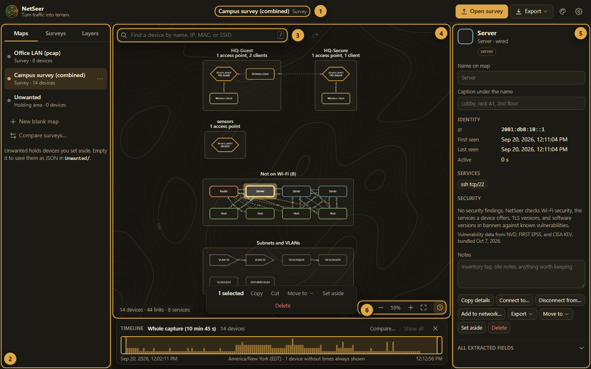

1. **Map title.** The map you're looking at. Click it to rename the map. **Open survey**, **Export**, the theme picker, and the **Settings** cog sit to its right.
2. **Sidebar.** Three tabs: **Maps** (every map you have open), **Surveys** (captures and samples), and **Layers** (what the map shows).
3. **Find a device.** Search by name, IP, MAC, SSID, or notes.
4. **The map.** Devices, the subnets they belong to, and the links between them. A toolbar appears at the bottom when you select something.
5. **Details.** Everything NetSeer found about the selected device or link.
6. **Zoom.** Tidy layout, zoom out, zoom level, zoom in, and fit to screen.

## Open your captures

Click **Open survey**, or drag capture files anywhere onto the NetSeer window. Each capture becomes its own map.

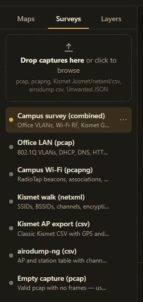

| Source | Files |
| --- | --- |
| Wireshark / tshark | `.pcap`, `.pcapng` |
| tcpdump | `.pcap` |
| Kismet | `.kismet` (its native log), `.pcap`, `.pcapng`, `.netxml`, `.csv` |
| airodump-ng | `.csv`, `.cap` |
| NetSeer | `Unwanted-*.json` dumps |

A Kismet `.kismet` log needs no converting: NetSeer reads its packets and Kismet's device list, including SSIDs, encryption, makers, the networks clients probed for, and access points that hide their network name (shown as **Hidden SSID**).

Installed copies open captures of any size, including long wardrives. A big file shows a progress bar with how much has been read and how many packets and devices so far. **Stop and show map** draws what's been read so far; **Cancel** discards it. The [online copy](https://netseer.onrender.com) takes captures up to 20 MB and says so when a file is bigger; install NetSeer for those. If something in a capture couldn't be read, a message says so, and the count of warnings appears at the bottom-left of the map.

The **Surveys** tab lists your captures and the bundled samples. Click one to open it. Right-click a survey (or use its **⋯** button) for more:

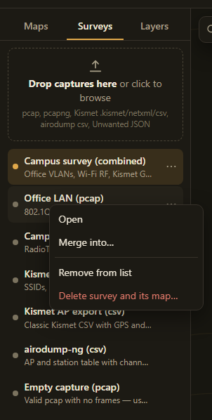

- **Merge into…** copies the survey's devices into a map you pick.
- **Remove from list** hides the survey and keeps its map under **Maps**. Click **Bring back** in the message to restore it.
- **Delete survey and its map…** removes both after asking. **Undo** brings the map back; **Bring back** in the message restores the survey to the list.

**Restore bundled samples** brings back any samples you removed. Drag surveys up or down to put them in the order you like.

## Read the map

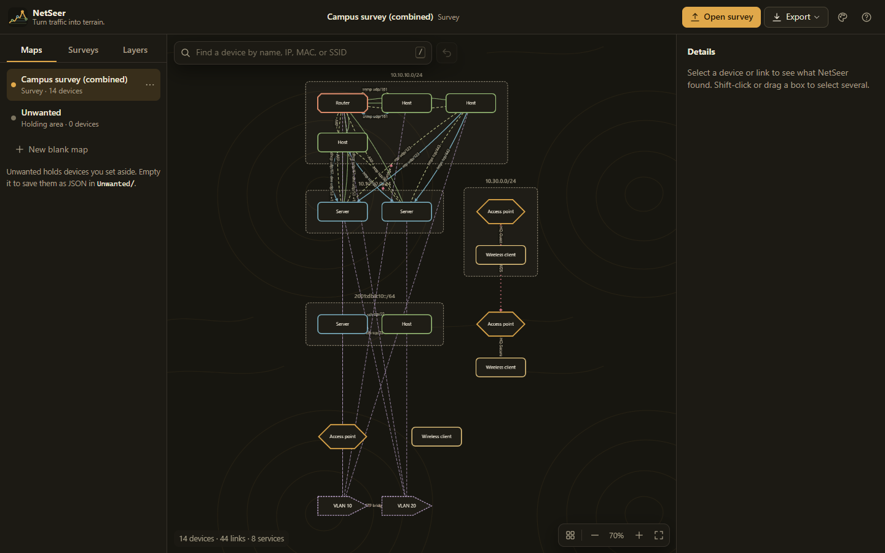

- **Boxes are subnets.** Each device sits inside the subnet it was seen in (for example `10.10.10.0/24`). Turn this off with **Group by subnet** in **Layers**.
- **Shapes and colours show the device type.** Access points are hexagons; routers and gateways have cut corners; servers, hosts, and wireless clients are rounded boxes in their own colours. VLANs are tag shapes. The legend is at the bottom of the **Layers** tab.
- **Lines are links.** Solid lines are wired neighbours, dashed lines are IP traffic, arrows run from a client to the service it used, and dotted pink lines with diamonds are bridges. Labels such as `http tcp/80` name the service.
- **Access points sit with their clients**, so you can see who is on which Wi-Fi network. Each access point shows its **SSID** (network name) under its name, such as `HQ-Secure`, or `HQ-Secure +2` when it broadcasts several. **Hidden SSID** means the survey shows the network hides its name. A caption you type replaces it, and you can turn SSIDs off in **Settings**.
- **Click a device** to select it: it gets a bright outline and glow, and its links are drawn on top. To fade everything that isn't connected to the device under the pointer, turn on **Fade unrelated devices on hover** in **Settings** (it's off by default).

Move around with the mouse: drag the background to pan and scroll to zoom (about 10% per notch). **Fit to screen** (or press `F`) frames everything.

**Drag** any device, or a whole subnet box, to rearrange the map. NetSeer remembers positions for each map. **Tidy layout** (the grid button by the zoom controls) puts everything back; you can undo it.

## Inspect a device

Click a device to see what NetSeer found.

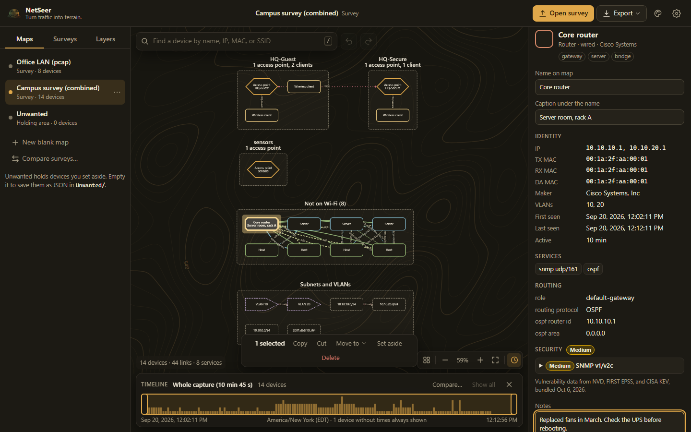

- **Name on map** and **Caption under the name** change how the device appears on the map. Here the router is renamed "Core router" with the caption "Server room, rack A". **Use auto name** goes back to the name NetSeer inferred.
- **Identity** shows IP and MAC addresses (with their TX/RX/DA/RA roles when the frames show them), the manufacturer from the MAC prefix, and VLANs.
- **Radio** (for wireless devices) shows SSIDs, channel, frequency, signal range, security, and GPS.
- **Services** and **Routing** show what it serves and what NetSeer learned from OSPF, DHCP, and DNS.
- **Notes** keeps anything you want to remember: asset tags, site notes, contacts.
- **Click any value** to copy it.

The buttons below copy a text summary of the device, export it, move it to another map, set it aside, or delete it from this map.

### Edit any field

Open **All extracted fields** for every value the parser found. Change any of them: the field is marked **Edited**, and **Reset** (shown when you hover the field) puts the captured value back. Your edits are used everywhere: on the map, in search, and in exports.

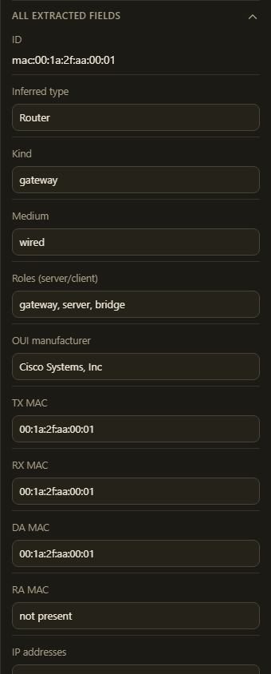

## Inspect a link

Click a line to see what it represents: the two ends, how many frames were seen, VLANs, and the services involved. For web traffic NetSeer also shows the HTTP host name it saw. **Remove this link** (in the details, or by right-clicking the line) takes it off the map without moving either device; you can undo it.

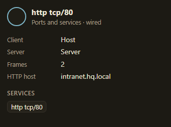

## Look at a time window

When a capture records times (pcap, pcapng, and Kismet logs do), a **timeline** sits under the map. It shows when the capture started and ended, and a chart of how many devices were active over time.

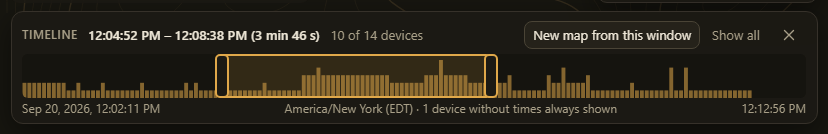

- **Drag the two handles** to pick a window. Only devices and links heard during it stay on the map; the rest disappear, and nothing moves. The bar shows the window, its length, and how many devices are in it.
- **New map from this window** makes a separate map of just that time: the devices and links heard in it (and any you added), with their activity trimmed to the window and your names, captions, and notes carried over. It's named after the window, lays out fresh, and its own timeline covers only that period. The original map is unchanged; Undo removes the new one.
- **Show all** goes back to the whole capture. The **×** hides the timeline (and shows everything); the **clock** button by the zoom controls brings it back.
- A device's **Details** show when it was first and last seen, and how long it was active. Links show the same.
- **Exports follow the window:** draw.io, Visio, and the PDF report include only what's on the map, and the report notes the window.
- Search still finds devices outside the window. They're marked, and picking one shows the whole capture again.

Devices that are heard again within a minute count as one stretch of activity. NetXML and CSV surveys don't record reliable times, so their devices (and any you add yourself) always show.

Times are shown in **this computer's time zone** unless you choose another in **Settings** → **General** → **Time**, along with a 12- or 24-hour clock. Captures record exact moments, so changing the zone only changes how they're written.

## Find a device

Press `/` or click **Find a device**, then type part of a name, caption, SSID, IP, MAC, maker, or note. Every match is listed, best first (names, then captions and SSIDs, then addresses, then makers), and each row says what matched, such as `SSID: NETGEAR66-5G` or `maker: NETGEAR`. Use the arrow keys and Enter, or click a result, to select that device and centre the map on it. **Select all on the map** selects every match at once.

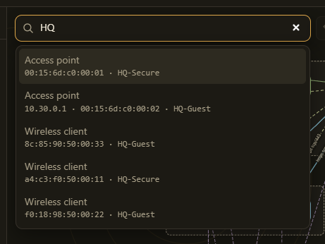

## Select, copy, and move devices

Shift-click (or Ctrl-click) to select several devices, or hold Shift and drag a box around them. The toolbar at the bottom and the details panel both offer **Copy**, **Cut**, **Move to**, **Set aside**, and **Delete**.

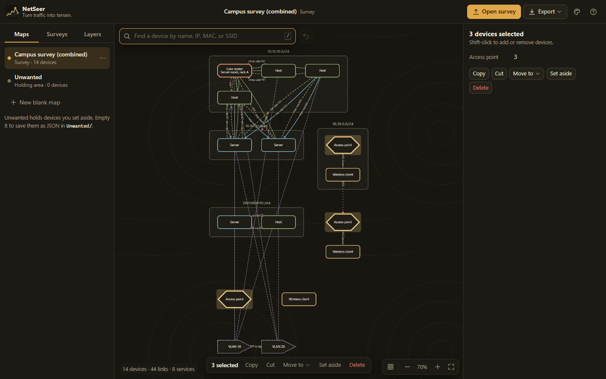

Right-click a device for the same actions:

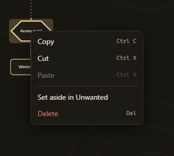

**Move to** sends devices straight to another map, or to a new one:

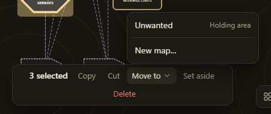

To copy instead, choose **Copy**, open the other map, and **Paste** (the button at the top of the map, or Ctrl+V). Names, captions, notes, and edits go with the devices. Links come along when both ends are copied.

**An access point brings its network.** Copying, cutting, or moving an access point also takes its associated wireless clients and any access points bridged to it. A wireless client on its own moves alone.

**Undo** (the left arrow at the top of the map, the **Undo** button in the message, or Ctrl+Z) reverses the last 30 changes. Each drag counts as one change, so Undo puts what you dragged back where it was. **Redo** (the right arrow, **Redo** in the message, or Ctrl+Y or Ctrl+Shift+Z) puts them back. Undo and Redo only change maps: devices, links, names, notes, and positions. They don't touch the clipboard, the Surveys list, the order of your maps, or settings.

## Work with several maps

The **Maps** tab lists every map. Click one to switch. Right-click a map, or use its **⋯** menu, to rename it, merge it into another map, or delete it.

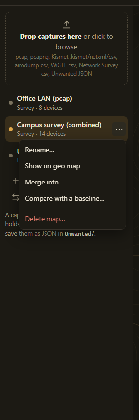

- **New blank map** starts an empty map to paste devices into, for example to draw just one site or one problem.
- **Merge into…** copies all of this map's devices into another map. The original map stays as it is.
- **Drag to organize.** Drag a map up or down the list to reorder it. Drop it **onto** another map to merge it into that map, with Undo. To merge a survey, drag it from **Surveys**, hold it over the **Maps** tab until the tab opens, then drop it on a map. Esc cancels a drag.
- **Resize the sidebar** by dragging its right edge, so long names fit. Double-click the edge to reset it. NetSeer remembers the width.
- **Unwanted** is a holding area for devices you set aside. Its **Save to files and empty** option writes them to JSON files (one per original capture) and clears it. Drop one of those files back onto NetSeer to reload it.

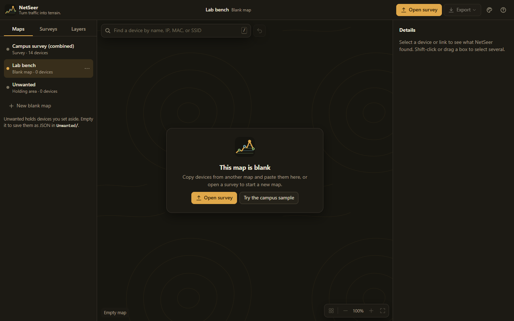

## Add what the capture didn't show

Sometimes you know more than the capture does: a switch port label, a network diagram, a note from IT. You can add that to the map, and it stays clearly marked as **added by you**, so it's never mistaken for something NetSeer saw.

**Connect two devices.** Right-click a device and choose **Connect to…**, then click the other device (Esc cancels). Or select two devices and click **Connect** in the toolbar. Choose how they're connected:

- **Wired**: a cable, switch port, or patch panel
- **Wi-Fi**: the client joins this access point (offered when one of the two is an access point). The client then sits with that access point on the map.
- **Other**: same network, same rack, uplink, VPN, or anything else

Add a short **label** for the map (such as `Port 14`) and a note on **where this came from**.

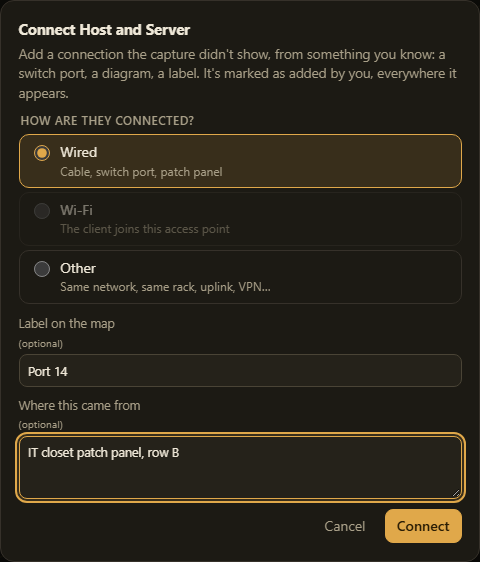

**Add a device to a subnet or VLAN.** Right-click it and choose **Add to subnet or VLAN…**. Pick one already on the map, or type a new one (`10.20.0.0/24`, or a VLAN number). With **Group by subnet** on, the device moves into that subnet's box.

**How they look.** Links you add keep their type's colour, with a dash-dot line and a ✎ pencil mark before the label. Click one to see when you added it, change its label or note, or **Remove this link**; right-click it for the same. The **Added by you** switch in **Layers** shows or hides them all.

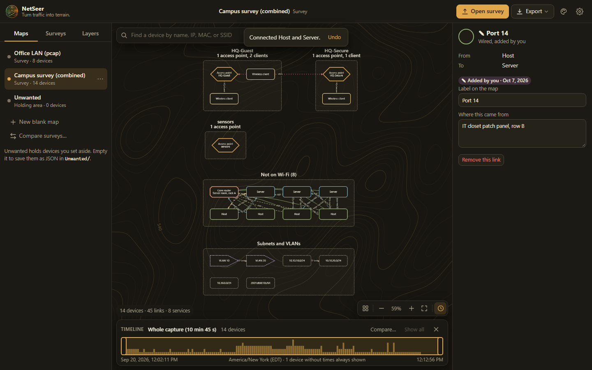

**Disconnect two devices.** The opposite of connecting: right-click a device, choose **Disconnect from…**, and click the other device. Or select two connected devices and click **Disconnect**. A short list shows every link between them (wired, IP traffic, Wi-Fi, ones you added), all ticked; untick any you want to keep. Nothing is deleted except those links, and every device stays exactly where it is on the map. Undo brings the links back.

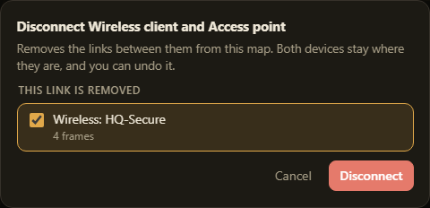

Everything you add is saved with the map, included in backups, and can be undone. Exports carry the mark too: draw.io and Visio use the dash-dot line and ✎ label, and the PDF report marks each one as "added by you" with your note.

## Show and hide layers

The **Layers** tab controls what's drawn, and how devices are arranged.

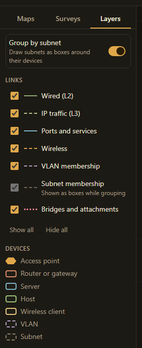

- **Arrange devices** picks the layout:
  - **By subnet** (the default) puts each device in its subnet's box, with access points beside their clients.
  - **By connection** puts devices that are linked next to each other. Each group of linked devices is its own cluster, biggest first. The busiest device (a gateway, switch, or access point) is in the middle, with what it connects to in rings around it, so lines stay short and rarely cross. Devices with no links follow in a grid, then the subnet and VLAN labels. Subnet and VLAN membership lines aren't drawn in this view; each device's details still show its subnet and VLANs.
  - **By location (GPS)** places devices where they were heard, using the GPS in Kismet and wardrive surveys. A label shows the scale. Devices without a location are grouped in a box beside them.
  - **By channel** makes a box per Wi-Fi channel, labelled with its band. Clients sit in their access point's channel; wired devices come last.
  - **By network name** makes a box per SSID with its access points and their clients. Handy for picking out every "NETGEAR" or guest network at once.
  - **Top-down hierarchy** puts gateways at the top, then what connects to them, level by level, like an org chart.
  - **By signal strength** places devices on dashed rings by how strongly they were heard, strongest in the middle, with each band's range labelled at the top. Devices with no signal reading are grouped separately.
  - **By maker** makes a box per manufacturer (from the MAC address), largest first.

  Every arrangement except **By subnet** draws its own labelled boxes; they aren't devices, so they can't be selected and aren't exported. Subnet and VLAN membership lines are drawn only in the subnet arrangement.

  Each arrangement keeps its own dragged positions, so switching back and forth never scrambles either one.

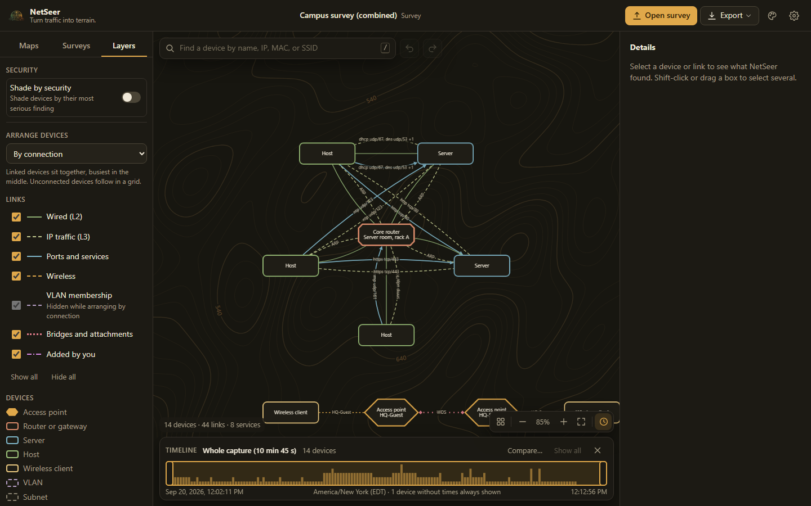

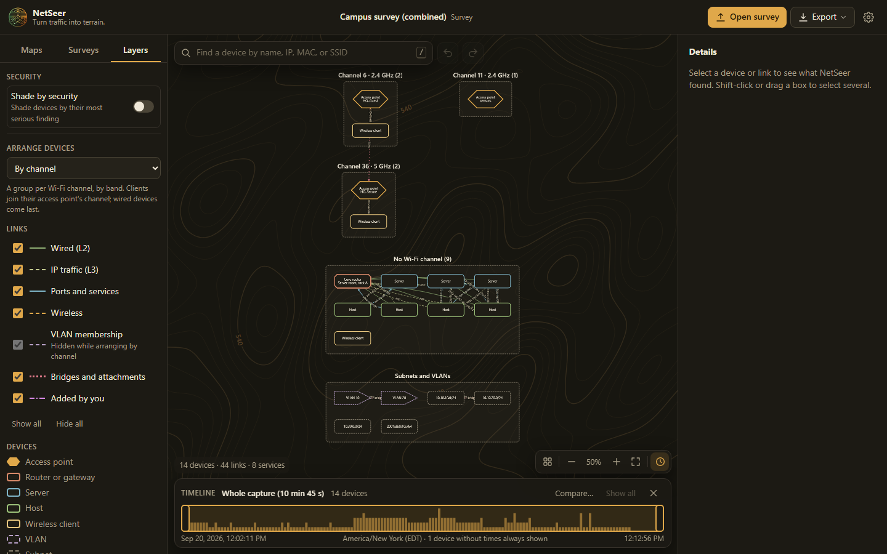

- **Group by subnet** draws subnets as boxes (in the subnet arrangement). Turn it off to show subnets as separate nodes with membership links instead.
- **Links** switches each kind of link on or off: wired, IP traffic, ports and services, wireless, VLAN membership, subnet membership, and bridges. Devices always stay visible.
- **Devices** is the legend for shapes and colours.

Your layer choices are remembered.

## Export diagrams and files

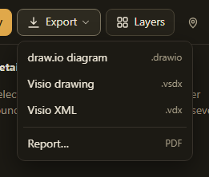

- **draw.io diagram** (`.drawio`), **Visio drawing** (`.vsdx`), and **Visio XML** (`.vdx`) use the layout you see on screen, including positions you dragged. Subnets become containers: in draw.io, moving a subnet box moves its devices.
- **Report…** makes a PDF of the map (see below).
- For a single device, use **Export** in its details panel: PDF, spreadsheet (CSV), XML, or plain text.

Your names, captions, notes, and field edits are included in every export.

## Create a PDF report

**Export → Report…** lets you choose what the PDF contains, so you can make a one-page summary or a full audit.

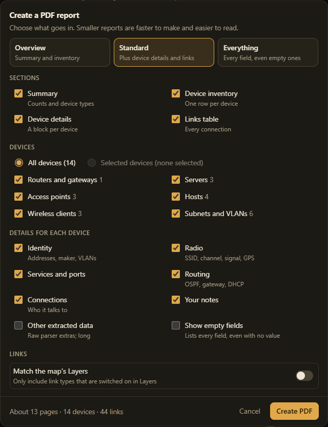

- **Presets**: **Overview** (summary and device list), **Standard** (adds a block per device and a links table), or **Everything** (every field, including empty ones).
- **Sections**: summary, device inventory, device details, links table.
- **Devices**: all devices or only the ones you selected, and which types to include.
- **Details for each device**: identity, radio, services and ports, routing, connections, your notes, and raw parser extras. **Show empty fields** lists fields with no value too.
- **Match the map's Layers** leaves out link types you've hidden.

The footer estimates the number of pages before you create the PDF, and NetSeer remembers your choices for next time.

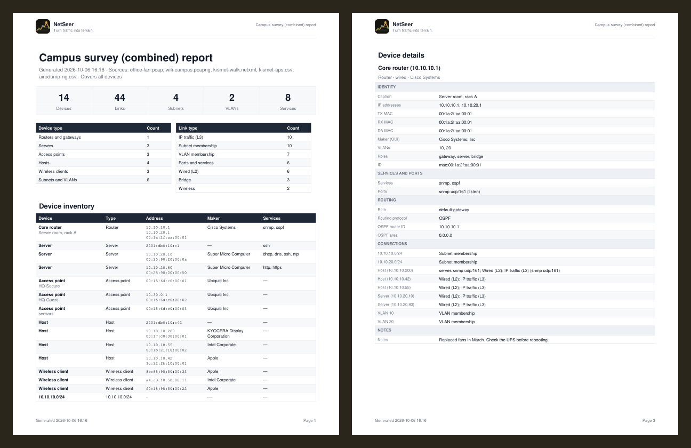

## Change the theme

Click the palette button in the top bar.

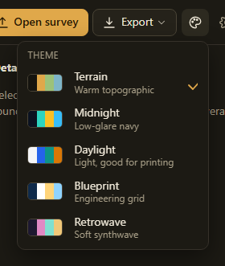

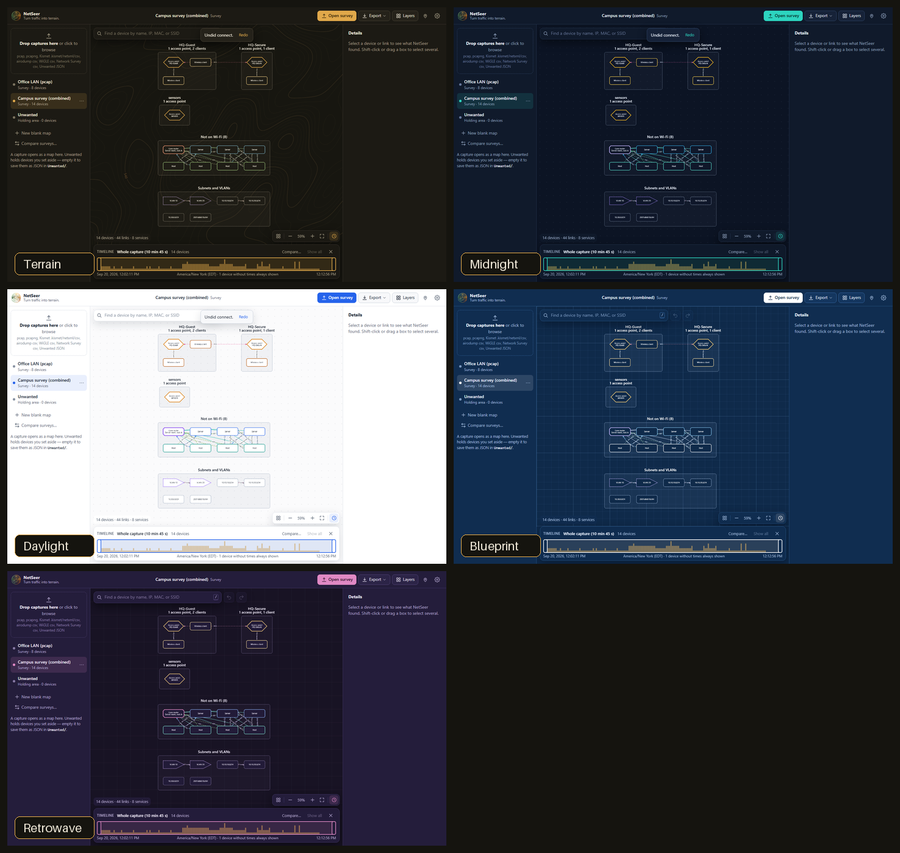

**Terrain** is the default. **Daylight** works best for screenshots, projectors, and printing. Themes change the app only; exported files keep their own colours.

## Keyboard shortcuts

Press `?`, or open **Settings** → **Help** → **Keyboard shortcuts**, to see them in NetSeer.

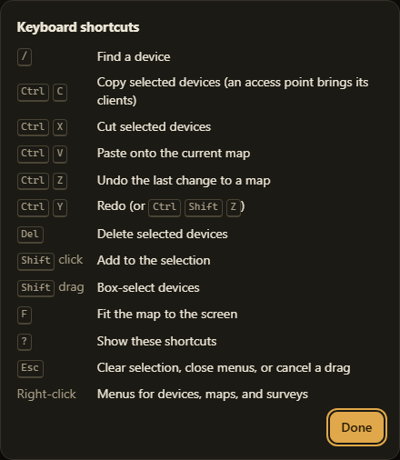

| Key | Action |
| --- | --- |
| `/` | Find a device |
| Ctrl/Cmd + C, X, V | Copy, cut, paste devices |
| Ctrl/Cmd + Z | Undo |
| Ctrl/Cmd + Y, or Ctrl/Cmd + Shift + Z | Redo |
| Delete or Backspace | Delete the selected devices |
| Shift + click, Shift + drag | Add to the selection, box-select |
| `F` | Fit the map to the screen |
| `?` | Show the shortcuts |
| Esc | Close menus, clear the selection, or cancel a drag |
| Right-click | Menus for devices, maps, and surveys |

## Settings, updates, and the tour

Click the **cog** at the right of the top bar. A dot on the cog means a newer version is out.

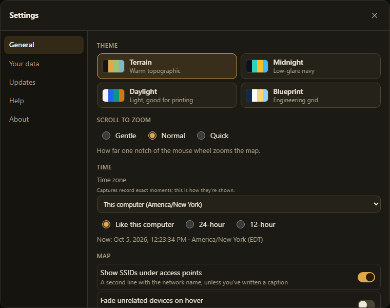

**General.** Pick a theme, choose how far one notch of the mouse wheel zooms (**Gentle**, **Normal**, or **Quick**), and turn subnet boxes, SSIDs under access points, and hover fading on or off. **Time** sets the time zone and 12- or 24-hour clock used for capture times on the timeline and in Details.

**Your data.** Shows how many maps and devices are saved in this browser.

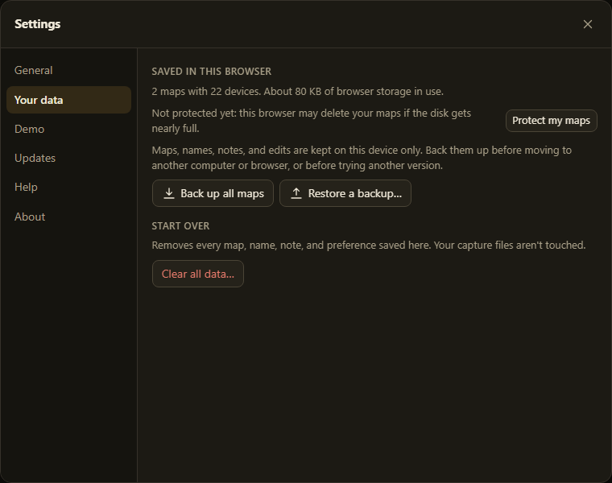

- **Back up all maps** downloads one `NetSeer-backup-<date>.json` file with every map, name, note, edit, position, and preference.
- **Restore a backup…** replaces what's saved here with a backup file. It asks first.
- **Clear all data…** removes everything saved here and starts fresh. It asks first. Your capture files aren't touched.
- The line above the buttons says whether your maps are **protected** from automatic cleanup. Browsers can delete a site's storage when the disk is nearly full; if yours isn't protected yet, click **Protect my maps**. See [How much you can store](../README.md#how-much-you-can-store).

Use a backup to move your maps to another computer or browser, or before trying a different version.

**Updates.** Shows your version and how NetSeer is installed. **Check for updates** asks GitHub for the list of releases. This is the only time NetSeer goes online, and nothing about you or your maps is sent.

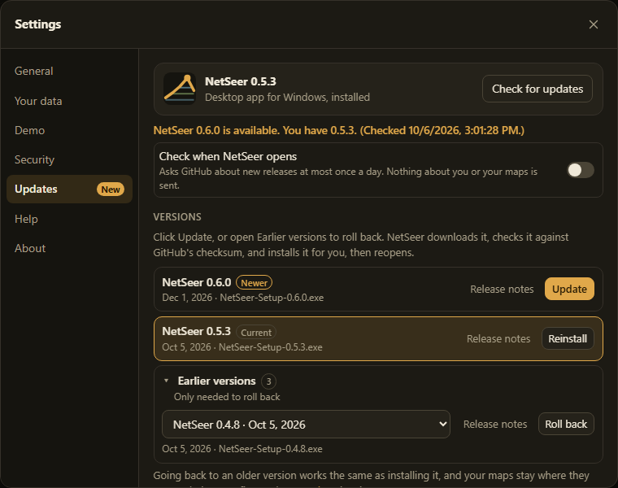

*The releases in this picture are an example.*

- **Update** gets a newer version. **Roll back** goes back to an older one, if a new release gives you trouble. Your maps stay where they are either way.
- In the **desktop app** (version 0.4.0 or later), either button opens the update wizard, described below.
- From **source**, the button copies a `uv tool install` command for that version instead.

#### The update wizard

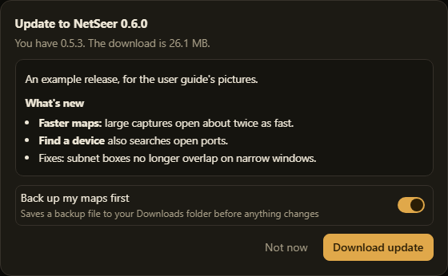

1. **What's new.** The wizard shows the release notes and the download size. Leave **Back up my maps first** on to save a backup file before anything changes.
2. **Download.** A progress bar shows the download from GitHub. NetSeer then checks the file's SHA-256 checksum against the one GitHub publishes for it. If they don't match, NetSeer deletes the file and installs nothing.
3. **Restart and update.** NetSeer closes, puts the new version in place, and reopens on its own with a message saying which version you're on.

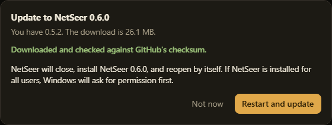

How the new version goes in depends on how you installed NetSeer:

| Install | What happens |
| --- | --- |
| Windows installer | The installer runs silently and reopens NetSeer. If NetSeer is installed for all users, Windows asks for permission first. |
| Windows portable zip, Linux `.tar.gz` | The new version goes in NetSeer's folder. The version you had is kept beside it in a folder ending in `.previous` until the next update. |
| Linux AppImage | The AppImage file is replaced where it is. |

Versions before 0.4.0 can't update themselves. If you go back to one, download later versions from GitHub yourself.
- **Check when NetSeer opens** (off by default) checks at most once a day and tells you once about each new release.
- The [online copy](https://netseer.onrender.com) updates itself, so it shows no list.

**Help.** Start the tour, see the keyboard shortcuts, open this guide, or report a problem on GitHub.

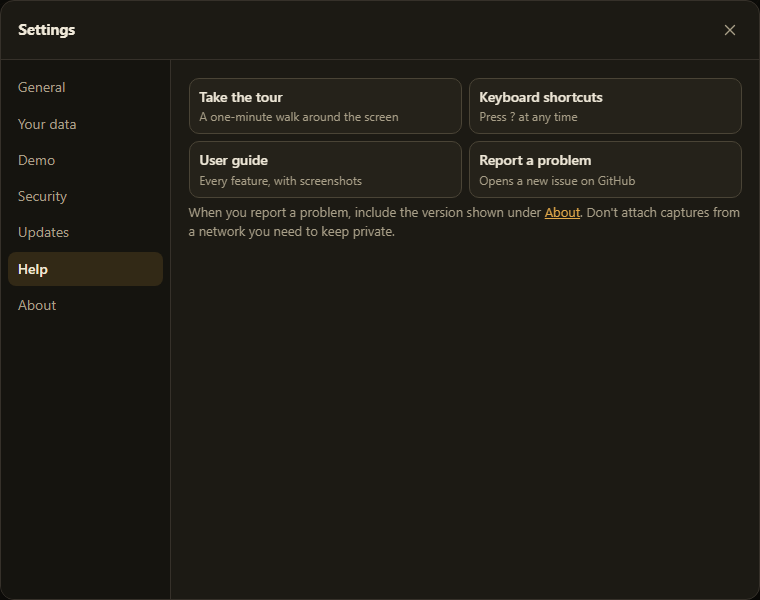

**About.** Version, how NetSeer is running, links, and the open-source components it's built with.

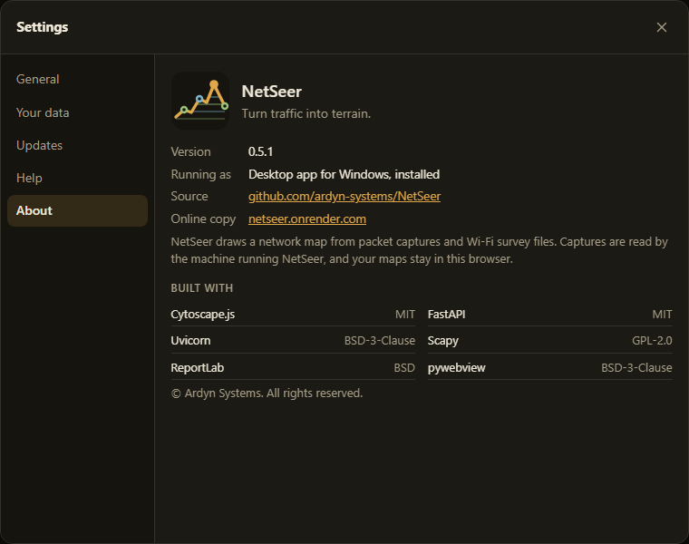

### The tour

On your first visit NetSeer offers a one-minute tour. You can start it any time from **Settings** → **Help** → **Take the tour**. It highlights each part of the screen in turn: opening surveys, the sidebar and how to organize it, the map, search, details, export, themes, and settings. Use **Next** and **Back** or the arrow keys. **Skip tour** or Esc ends it.

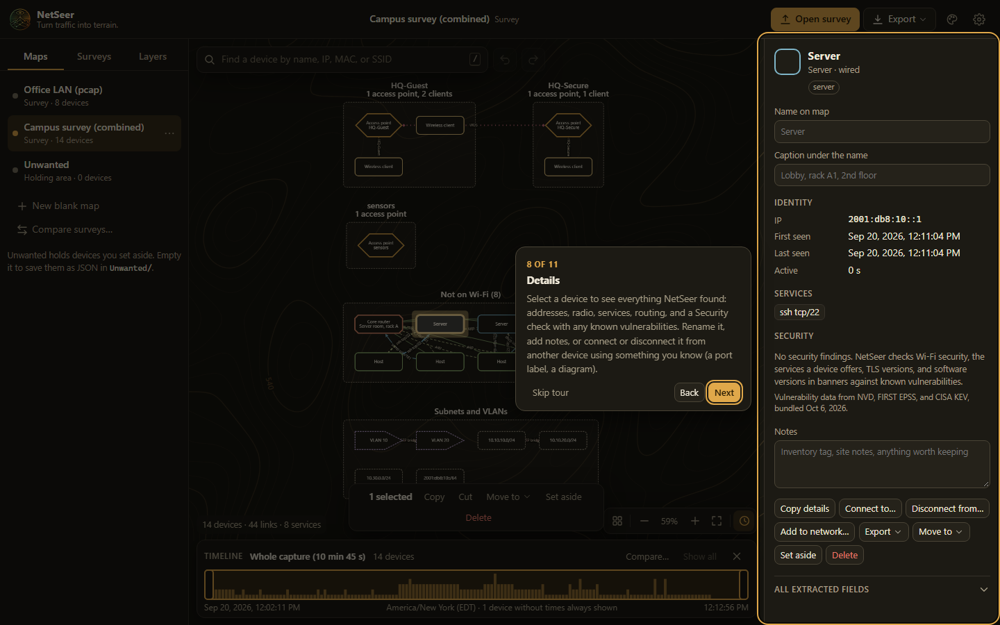

## Where your work is saved

NetSeer never changes your capture files. Maps, names, notes, edits, and positions are saved automatically on your computer:

| | Windows | Linux |
| --- | --- | --- |
| Saved maps (desktop app) | `%LOCALAPPDATA%\NetSeer\webview` | `~/.local/share/NetSeer/browser` |
| Unwanted files | `Documents\NetSeer\Unwanted` | `~/Documents/NetSeer/Unwanted` |
| Log | `%LOCALAPPDATA%\NetSeer\netseer.log` | `~/.local/share/NetSeer/netseer.log` |

If you run NetSeer from source and use your normal browser, maps are saved in that browser for `http://127.0.0.1:47331`. Clearing that site's data removes them.

To keep a copy, or to move your maps somewhere else, use **Settings** → **Your data** → **Back up all maps**.

## Troubleshooting

**Windows says "Windows protected your PC".** The builds aren't code-signed yet. Choose **More info** → **Run anyway**.

**"NetSeer is already open."** Only one copy runs at a time. Look for its window on the taskbar.

**My maps are missing.** Maps are saved per address and per browser. If another program was using port 47331, NetSeer picked the next free port and its maps are kept separately; the log says which port it used. On Linux, maps saved in the app window and maps saved in your normal browser are separate too.

**NetSeer opened in my web browser instead of a window.** On Windows, install [Microsoft Edge WebView2](https://go.microsoft.com/fwlink/p/?LinkId=2124703). On Linux, install Chrome, Chromium, Edge, Brave, or Vivaldi for a separate app window. In the browser, NetSeer quits by itself a couple of minutes after you close its tab.

**A capture won't open.** Check that it's one of the [supported formats](#open-your-captures). In the online copy, it must be under 20 MB; installed copies have no limit. Files that parse but contain no devices say "No hosts, access points, or links were found".

**A new version is misbehaving.** Open **Settings** → **Updates**, click **Check for updates**, and choose **Roll back** on the version that worked. The wizard backs up your maps first.

**An update didn't finish.** Open NetSeer from the Start menu or app menu. On Windows, the installer's log is `%LOCALAPPDATA%\NetSeer\update-install.log`. For a portable copy, the version you had is still in the folder ending in `.previous`. You can always download the release from GitHub and install it the usual way.

**Something else looks wrong.** The log (see the table above) has the details. Run `NetSeer --smoke-test` (or `NetSeer.exe --smoke-test`) to check the installation; exit code 0 means it's working.

---

The screenshots in this guide come from `docs/screenshots.py`, which drives NetSeer with Playwright. To refresh them after changing the interface, see the instructions at the top of that file.
